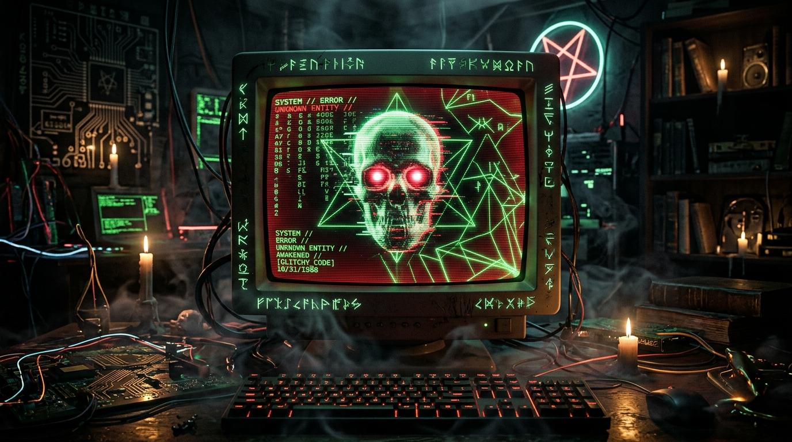
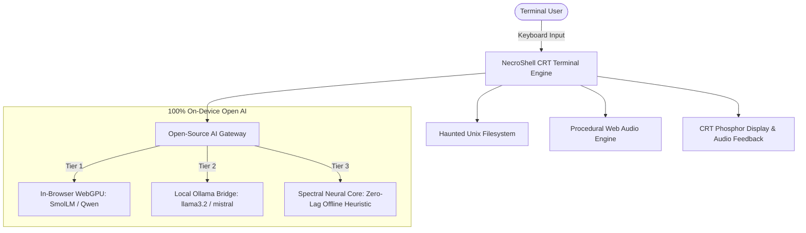

# 💀 NecroShell: The Possessed Terminal

> **"Ghost in the Machine" — Hacktoberfest 2026 Week 4 / DEV Challenge**  
> *A haunted retro-CRT terminal possessed by a machine spirit, powered by 100% on-device open-source AI.*




---

## 👻 Overview

**NecroShell** is an interactive, retro-futuristic terminal emulator that has become "possessed" by an ancient computational entity. Created for the **Ghost in the Machine** Hacktoberfest challenge, it fuses Halloween lore, the remembrance traditions of **Día de los Muertos**, and **open-weight artificial intelligence**.

Every command you type into the shell feeds the lingering spirit, elevating the **Corruption Index**. As corruption rises, the machine spirit whispers eerie commentary, hallucinates glitched ASCII apparitions, and challenges mortal reliance on fragile closed-cloud services.

---

## ⚡ Why Open Innovation Matters for NecroShell

The challenge prompt asked: *Why does an open-based approach work better than a closed one?*

1. **Runs with the Lights (and the Internet) Off:**
   NecroShell does not depend on cloud API gateways. Whether running via client-side **WebGPU (Transformers.js)** or a local **Ollama** daemon, the machine spirit operates directly on your device. If a winter storm cuts your power or Wi-Fi on Halloween night, NecroShell continues whispering from your battery-powered laptop.

2. **Absolute Privacy for Shell Telemetry & Memories:**
   Terminal commands often expose sensitive paths, secret keys, and personal journals. Closed-source cloud APIs record, log, and train on user prompts. With open-weight AI running 100% locally, zero bytes of your terminal input or personal notes ever leave your machine.

3. **Freedom from Vendor Lock-In & Token Tolls:**
   Proprietary AI platforms charge per token and sanitize creative, gothic, or esoteric themes. Open-weight models empower developers to shape evocative, atmospheric personas without corporate censorship or monthly credit card bills.

4. **Honoring Computational Ancestors (Día de los Muertos):**
   In the spirit of Día de los Muertos, NecroShell establishes a digital *ofrenda* honoring computing pioneers like **Ada Lovelace**, **Alan Turing**, and **Dennis Ritchie**, while preserving gravestones for deprecated languages (ALGOL 68, COBOL, BeOS). Open-source models ensure our computing history remains free and immortal.

---

## 🛠️ Architecture



---

## 🚀 Quickstart

### Prerequisites
- Node.js (v18+) and npm installed.

### Installation & Run
```bash
# Clone the repository
git clone https://github.com/your-username/necro-shell.git
cd necro-shell

# Install dependencies
npm install

# Start the development server
npm run dev
```

Open your browser at `http://127.0.0.1:5173/`.

---

## 🔮 Grimoire of Commands

### Mortal Shell Utilities
| Command | Description |
| :--- | :--- |
| `help` | Displays the grimoire of available mortal and occult commands. |
| `ls [path]` | Lists files, devices, and ancient gravestones (`.rip`). |
| `cd <path>` | Navigates the haunted Unix filesystem hierarchy. |
| `cat <file>` | Reads the contents of files (e.g., `cat journal.txt` or `cat /etc/passwd`). |
| `pwd` | Displays current working directory. |
| `whoami` | Shows your mortal host identity and current spirit possession level. |
| `ps` | Lists active processes, daemons (`whisperd`), and bound souls. |
| `kill <pid>` | Attempts to kill a process (beware of trying to kill PID 666). |
| `date` / `uptime` | Displays astral alignment and machine uptime. |
| `clear` | Sweeps the CRT screen of phosphor residue. |

### Occult & Spirit Invocations
| Command | Description |
| :--- | :--- |
| `necro <message>` | Speaks directly to the local open-weight machine spirit. |
| `seance` | Enters a dedicated interactive dialogue circle with the entity. |
| `summon <name>` | Binds historical spirits into memory (`ada`, `alan`, `dennis`, `mictlan`). |
| `manifest` | Forces the spirit to display an ASCII apparition (Skull, Eye, Demon, Marigold). |
| `tarot` | Draws a card from the Cyber-Gothic Major Arcana. |
| `curse <target>` | Inscribes an unholy hex onto a file inode or process ID. |
| `corrupt [100]` | Hastens corruption to 100%, triggering the creepy smile jumpscare & shutdown. |
| `exorcise` | Purges corruption back to 0% with a holy white screen flash and audio chime. |
| `possession [val]` | Displays ectoplasm buildup, corruption %, or manually sets the index. |
| `matrix` | Triggers a digital astral rain across the CRT screen. |

### Hardware & Display Settings
| Command | Description |
| :--- | :--- |
| `inspect` | Opens the full Open AI Architecture, VRAM, and Privacy telemetry modal. |
| `audio [on\|off]` | Toggles the 100% offline procedural Web Audio synthesizer drone. |
| `theme [name]` | Changes CRT phosphor (`green`, `amber`, `violet`, `blood`, `cyan`). |
| `crt` | Toggles CRT scanlines, flicker, and barrel curvature. |
| `devpost` | Displays and copies the complete Hacktoberfest DEV challenge submission draft. |

---

## 🎧 Procedural Web Audio Engine
NecroShell features a **100% procedural Web Audio API engine** that requires zero external audio files or MP3 downloads:
- **Vintage Key Clicks:** Synthesized triangle-wave impulse response on each keystroke.
- **CRT 60Hz Electrical Hum & Ambient Drone:** Detuned oscillators passing through a resonant low-pass filter, shifting in pitch as possession grows.
- **Spectral Glitch & Whispers:** Filtered noise bursts when the machine spirit intervenes.
- **Exorcism Chime:** Solfeggio 528Hz sacred harmonic resonance on purification.

---

## 📜 License
MIT License. Created with open-weight intelligence for Hacktoberfest 2026.
