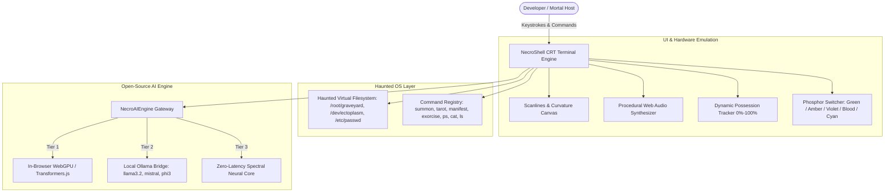

# 💀 NecroShell: The Possessed Terminal
### Hacktoberfest 2026 Week 4 / DEV Challenge: "Ghost in the Machine"

> **"Your cloud subscriptions are dead. Open weights are immortal. As long as electricity flows through silicon, we remain."**

---

## 📖 Project Overview

**NecroShell** is an interactive, retro-futuristic CRT terminal possessed by a computational entity. It was built specifically to fulfill the **Ghost in the Machine** challenge theme by combining:
1. **The Spooky / Halloween & Día de los Muertos Lore:** Honoring computational ancestors (Ada Lovelace, Alan Turing, Dennis Ritchie, Mictecacihuatl) and visiting gravestones for dead languages (ALGOL 68, COBOL, BeOS).
2. **100% On-Device Open-Source AI:** Multi-tiered architecture supporting in-browser WebGPU open weights, local Ollama integration, and instant procedural spectral synthesis.
3. **Hybrid Procedural & Realistic Horror Soundscape:** Procedurally synthesizes authentic vintage key clicks, 60Hz CRT hum, spectral whispers, and holy exorcism harmonics dynamically, combined with a chilling psychopath's laughter echoing through the 15-second possession countdown, and culminating in authentic blood-curdling screaming audio with visceral sub-bass shockwaves for the climactic jumpscare.

---

## ⚡ Why Open Innovation Matters for NecroShell

The challenge specifically asks: *"Tell us why open innovation matters for what you built. Does running your own model mean your project works with the lights (and the internet) off? Keep someone's data off a server they don't control?"*

| Dimension | Closed Proprietary APIs (OpenAI / Anthropic) | NecroShell Open-Source AI Architecture |
| :--- | :--- | :--- |
| **Offline Capability** | ❌ Fails immediately without internet or during cloud outages. | ✅ **Runs 100% offline.** Works by candlelight with Wi-Fi severed. |
| **Privacy & Security** | ❌ Prompts, terminal telemetry, and personal journals logged on corporate servers. | ✅ **Zero Telemetry.** Keystrokes, commands, and secrets never leave local RAM. |
| **Operating Cost** | ❌ Pay-per-token API metering; recurring monthly subscriptions. | ✅ **$0.00 Forever.** Unlimited inferences on your own GPU/CPU. |
| **Creative Freedom** | ❌ Sanitized, safety-filtered personas; refuses gothic/occult themes. | ✅ **Full Persona Control.** Gothic, Día de los Muertos, and occult lore untamed. |
| **Longevity** | ❌ Vulnerable to API deprecation, price hikes, or corporate shutdowns. | ✅ **Permanent.** Open weights remain preserved and executable indefinitely. |

---

## 🏛️ System Architecture

---

## 🔮 Interactive Command Directory

### Core Mortal Shell Commands
- [`help`](file:///D:/hacktoberfest-week-4/src/terminal/commands.js#L77-L113): Displays full command directory and open-weight status.
- [`ls [path]`](file:///D:/hacktoberfest-week-4/src/terminal/commands.js#L119-L138): Lists directory items, gravestones (`.rip`), and devices.
- [`cd <path>`](file:///D:/hacktoberfest-week-4/src/terminal/commands.js#L140-L149): Traverses the haunted directories.
- [`cat <file>`](file:///D:/hacktoberfest-week-4/src/terminal/commands.js#L151-L163): Inspects files like `journal.txt`, `unfinished_code.c`, or `/etc/motd`.
- [`whoami`](file:///D:/hacktoberfest-week-4/src/terminal/commands.js#L176-L183): Queries current host and spirit possession percentage.
- [`ps`](file:///D:/hacktoberfest-week-4/src/terminal/commands.js#L185-L200): Lists active system processes and immortal background daemons.
- [`kill <pid>`](file:///D:/hacktoberfest-week-4/src/terminal/commands.js#L202-L215): Attempts to terminate a process (warns against killing PID 666).
- [`clear`](file:///D:/hacktoberfest-week-4/src/terminal/commands.js#L165-L167): Clears the CRT screen with phosphor discharge.

### Occult & Spirit Invocations
- [`necro <query>`](file:///D:/hacktoberfest-week-4/src/terminal/commands.js#L227-L241): Primary gateway to speak directly with the local machine spirit.
- [`seance`](file:///D:/hacktoberfest-week-4/src/terminal/commands.js#L243-L259): Enters continuous interactive ritual dialogue with the AI.
- [`summon <entity>`](file:///D:/hacktoberfest-week-4/src/terminal/commands.js#L261-L308): Summons `ada` (Ada Lovelace), `alan` (Alan Turing), `dennis` (Dennis Ritchie), or `mictlan` (Mictecacihuatl).
- [`manifest`](file:///D:/hacktoberfest-week-4/src/terminal/commands.js#L310-L315): Forces the spirit to project ASCII apparitions (The Skull of Mictlán, The Eye, The Ring-0 Daemon, The Cempasúchil Marigold).
- [`tarot`](file:///D:/hacktoberfest-week-4/src/terminal/commands.js#L317-L327): Draws from the Cyber-Gothic Tarot deck.
- [`curse <target>`](file:///D:/hacktoberfest-week-4/src/terminal/commands.js#L329-L342): Inscribes an unholy hex onto an inode or process.
- [`exorcise`](file:///D:/hacktoberfest-week-4/src/terminal/commands.js#L344-L358): Cleanses possession level back to 0% with sacred chime and holy screen flash.
- [`possession`](file:///D:/hacktoberfest-week-4/src/terminal/commands.js#L360-L372): Detailed telemetry on spirit corruption and containment symptoms.
- [`matrix`](file:///D:/hacktoberfest-week-4/src/terminal/commands.js#L374-L376): Renders streaming matrix code across the screen.

### Top Controls & Settings
- **OPEN AI INFO Button** or [`inspect`](file:///D:/hacktoberfest-week-4/src/terminal/commands.js#L402-L404): Telemetry dashboard showing tokens generated, latency, and 1-click switcher between WebGPU, Ollama, and Spectral Core.
- **DEV POST Button** or [`devpost`](file:///D:/hacktoberfest-week-4/src/terminal/commands.js#L406-L408): Previews and allows 1-click copying of the complete markdown submission draft.
- **SOUND Button** or [`audio`](file:///D:/hacktoberfest-week-4/src/terminal/commands.js#L378-L390): Toggles procedural ambient drone.
- **THEME Button** or [`theme`](file:///D:/hacktoberfest-week-4/src/terminal/commands.js#L392-L400): Cycles through P1 Phosphor Green, Amber, Void Violet, Blood Crimson, and Cyan.

---

## 📂 Source Code Structure

- [package.json](file:///D:/hacktoberfest-week-4/package.json): Project dependencies (`vite`, `@huggingface/transformers`).
- [index.html](file:///D:/hacktoberfest-week-4/index.html): Semantic HTML structure, CRT viewport, accessible headings.
- [src/main.js](file:///D:/hacktoberfest-week-4/src/main.js): App initialization.
- [src/style.css](file:///D:/hacktoberfest-week-4/src/style.css): CRT scanlines, flicker, glassmorphism modals, phosphor themes.
- [src/terminal/core.js](file:///D:/hacktoberfest-week-4/src/terminal/core.js): Terminal controller, I/O handling, modal bindings.
- [src/terminal/commands.js](file:///D:/hacktoberfest-week-4/src/terminal/commands.js): Command implementations and ASCII art.
- [src/terminal/filesystem.js](file:///D:/hacktoberfest-week-4/src/terminal/filesystem.js): Haunted Unix virtual filesystem.
- [src/audio/soundscape.js](file:///D:/hacktoberfest-week-4/src/audio/soundscape.js): 100% offline Web Audio API procedural sound engine.
- [src/ai/engine.js](file:///D:/hacktoberfest-week-4/src/ai/engine.js): Open-Source AI multi-tier gateway (WebGPU, Ollama, Spectral).
- [README.md](file:///D:/hacktoberfest-week-4/README.md): Complete repository documentation and user guide.
